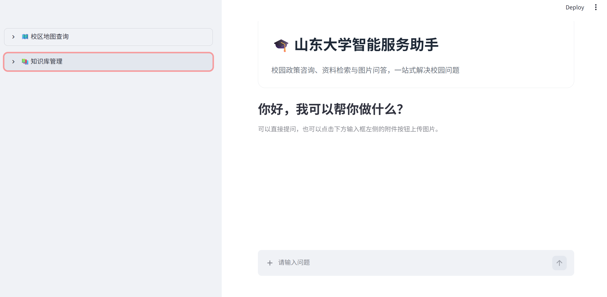

# 校园智能服务助手



基于 LangChain、LangGraph、Chroma 和 Streamlit 构建的校园智能问答项目。项目通过 RAG（检索增强生成）检索本地校园资料，并结合对话 Agent 为用户提供校园政策咨询、资料检索和图片问答服务。

## 功能

- 基于本地 TXT/PDF 资料的语义检索与问答
- 支持多轮对话，并保留当前会话上下文
- 支持上传、删除和同步知识库资料
- 支持上传图片进行图片问答
- 支持查看山东大学各校区地图
- 回答中展示参考资料来源
- 使用 Chroma 持久化向量数据库

## 技术栈

- Python 3.13+
- Streamlit
- LangChain / LangGraph
- ChromaDB
- DeepSeek：对话模型
- DashScope：文本向量模型

## 快速开始

### 1. 安装依赖

### 2. 配置模型密钥

编辑 [agent_university/config/rag.yml](agent_university/config/rag.yml)，配置以下字段：

```yaml
chat_model_name: deepseek-flash
embedding_model_name: text-embedding-v4
DEEPSEEK_API_KEY: your-deepseek-api-key
DEEPSEEK_BASE_URL: https://api.deepseek.com
DASHSCOPE_API_KEY: your-dashscope-api-key
```

请勿将真实 API 密钥提交到 Git。建议在提交前检查 `rag.yml`、`.env` 等配置文件，并使用密钥管理服务或本地未跟踪配置保存敏感信息。

### 3. 启动校园助手

在项目根目录执行：

```powershell
cd agent_university
streamlit run app.py
```

启动后，按照终端输出的地址打开浏览器即可使用。

## 使用说明

### 知识库

默认知识库目录为 [agent_university/data](agent_university/data)。将 `.txt` 或 `.pdf` 文件放入该目录后，应用会检测文件变化并同步向量库。也可以在侧边栏上传或删除资料，再点击同步按钮。

向量库和文本切分参数位于 [agent_university/config/chroma.yml](agent_university/config/chroma.yml)，包括：

- `persist_directory`：Chroma 数据目录
- `k`：每次检索返回的候选片段数
- `min_relevance_score`：最低相关性分数
- `chunk_size` / `chunk_overlap`：文本切分参数

### 校区地图

将 PNG、JPG、JPEG 或 WEBP 图片放入 [agent_university/map](agent_university/map)，应用会在侧边栏自动加载并提供校区选择。

## 项目结构

```text
agent_university/
├── app.py                    # Streamlit 应用入口
├── react_agent.py            # 对话 Agent
├── config/                   # 模型、RAG、向量库和提示词配置
├── data/                     # 知识库原始资料
├── map/                      # 校区地图
├── model/                    # 对话模型和向量模型工厂
├── rag/                      # RAG 检索与总结服务
├── tools/                    # Agent 工具
├── prompts/                 # 系统提示词和报告提示词
├── utils/                    # 配置、日志、文件等公共工具
└── chroma_db/                # Chroma 持久化数据
```

仓库中还包含 [RAG](RAG)、[agent](agent) 和 [agent_sichu](agent_sichu) 等实验代码和示例，校园智能助手的推荐入口是 `agent_university/app.py`。

## 常用命令

```powershell
# 启动校园助手
cd agent_university
streamlit run app.py

# 运行 RAG 服务示例
python -m rag.rag_service

# 查看项目状态
git status
```

## 注意事项

- 首次启动会加载模型并创建或更新 Chroma 向量库，耗时取决于知识库文件数量。
- 修改模型配置或知识库切分参数后，必要时请删除对应的 Chroma 数据目录并重新同步。
- `chroma_db`、日志和本地会话数据可能包含运行时生成内容，提交前请确认是否需要纳入版本控制。
- 项目中的问答结果由模型生成，仅供参考；涉及学校规章制度时请以学校官方发布的最新文件为准。
